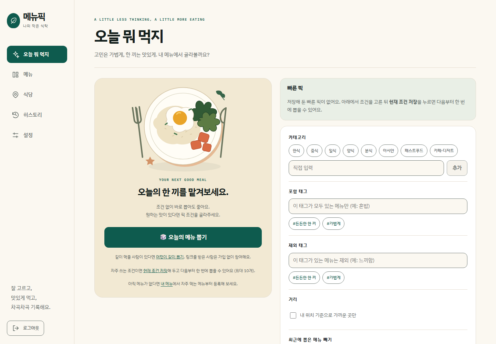
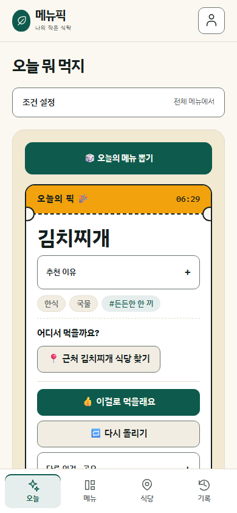
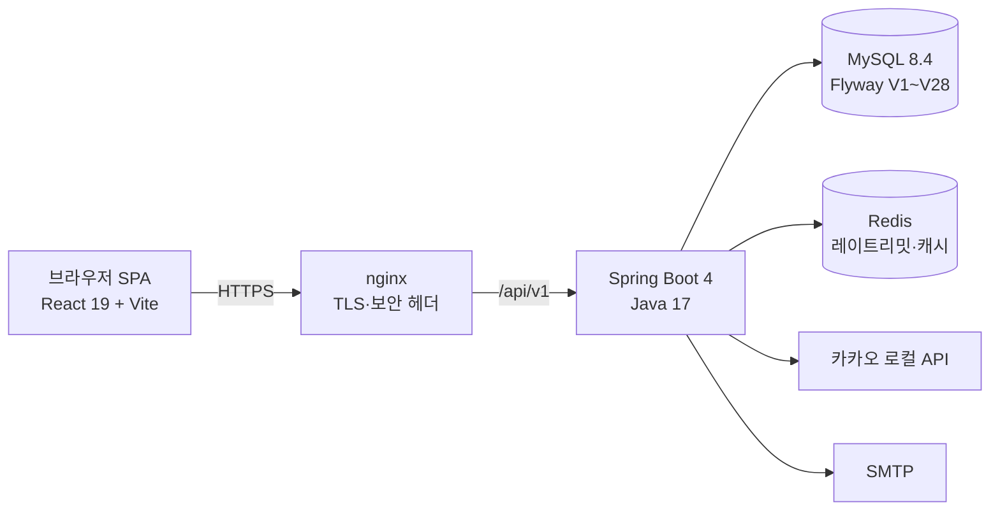

# 메뉴픽 Menu Pick

> **"오늘 뭐 먹지?"를 내 데이터로 끝내는 개인화 메뉴 추천 서비스**

저장해 둔 메뉴·맛집과 지난 기록을 바탕으로 한 끼를 골라 준다. 태그·카테고리로 후보를 좁히고,
최근에 먹은 것과 "별로였어" 피드백을 반영해 뽑는다. 혼자 정하기 어려우면 링크로 친구를 불러 같이 고른다.

<p>
  
  
</p>

## 주요 기능

- **픽(추천)**: 카테고리·포함/제외 태그·거리로 좁힌 뒤 가중 랜덤. 최근 3일 중복 완화, 30일 피드백 보정,
  잠시 제외, 저장형 프리셋, 후보가 없을 때 안전한 조건 조정안 제시.
- **메뉴·맛집 기록**: 태그, 메뉴별 식당(카카오 로컬 검색·지도), 별점·메모, 휴지통.
- **히스토리**: 방문 처리·메모·시간, 방문 달력, CSV 내보내기.
- **열량·영양**: 식약처 음식 DB(약 1.8만 행)에서 1인분 열량·탄단지·당류·나트륨을 골라 연결, 기간 그래프.
- **같이 고르기**: 링크로 들어온 사람들이 메뉴를 거부(veto)하고 한 번만 결과를 정하는 방.
- **계정**: 이메일 가입(메일 인증)·카카오/구글 로그인, 탈퇴 유예와 하드 삭제.

## 구성



- `src/` — 백엔드(레이어드: Controller → Service → Repository, 외부 연동은 Client로 분리)
- `frontend/` — 프론트엔드. [frontend/README.md](frontend/README.md)
- `deploy/oci/` — 운영 서버 구성·배포 스크립트. [deploy/oci/README.md](deploy/oci/README.md)
- `scripts/` — 백업·감시·기준 음식 가져오기, `scripts/k6/` 부하 테스트

## 숫자로 보는 상태

| 항목 | 값 |
| --- | --- |
| 백엔드 테스트 커버리지 | LINE 하한 91% / BRANCH 하한 79% (CI가 막음, [D-030](docs/DecisionLog.md#d-030-테스트-커버리지-하한--목표치가-아니라-래칫)) |
| 부하 시험 (운영 VM, ARM 4 OCPU) | 픽 100 rps에서 P95 30ms, 처리량 천장 ≈390 rps, 주변 조회 동시 500명 P95 91ms ([결과](docs/LoadTestResults.md)) |
| PR 필수 검사 | 백엔드 테스트, 프론트(lint·build·Vitest·Playwright), 이미지 빌드, 이미지 취약점 스캔 2종, npm audit |
| 보안 검사 | CodeQL, Dependabot, Trivy, Checkstyle, CycloneDX SBOM |
| 설계 결정 기록 | [DecisionLog.md](docs/DecisionLog.md) D-001~ (검토한 대안과 트레이드오프) |

설계에서 고민한 지점은 결정 기록에 대안과 함께 남겨 두었다. 예를 들면
픽 한 번의 DB 왕복 줄이기(D-088), 커밋 내구성을 처리량과 바꾸지 않은 이유(D-089),
익명 링크로 여는 같이 고르기 방의 남용 방지, 기준 음식 데이터의 1인분 정합성(D-090).

## 시작하기 (백엔드)

의존 서비스를 먼저 띄운다. MySQL·Redis 없이는 앱이 기동하지 않는다.

```bash
docker compose up -d          # mysql(3306), redis(6379), mailpit(1025/8025)
```

`JWT_SECRET`은 기본값이 없다 — 없으면 기동 단계에서 실패한다. 의도적으로 기본값을 두지 않았다([D-008](docs/DecisionLog.md#d-008-jwt-시크릿-기본값-제거)). HS256이라 **최소 256비트(32바이트 이상)** 여야 한다.

```bash
export JWT_SECRET="아무렇게나-길게-32바이트-이상-되는-로컬-전용-값"
./gradlew bootRun             # http://localhost:8080, 프로파일 기본값은 local
```

스키마는 Flyway가 기동 시 적용한다(`src/main/resources/db/migration`). API 문서는 local 프로파일에서만 열린다 — <http://localhost:8080/swagger-ui.html>.

**메일**: local 프로파일은 SMTP를 지정하지 않아 인증 링크를 로그(WARN)로 떨어뜨린다. 실제 발송까지 보려면 compose의 mailpit을 쓴다 — `SPRING_MAIL_HOST=localhost SPRING_MAIL_PORT=1025`로 띄우고 받은 메일은 <http://localhost:8025>에서 확인한다.

### 검증

```bash
./gradlew check               # 테스트 + 커버리지 하한 (CI가 도는 것과 같다)
./gradlew test                # 테스트만
```

`check`에는 JaCoCo 커버리지 게이트가 포함된다([D-030](docs/DecisionLog.md#d-030-테스트-커버리지-하한--목표치가-아니라-래칫)). 통합 테스트는 Testcontainers로 실제 MySQL·Redis·SMTP 컨테이너를 띄우므로 **Docker가 떠 있어야 한다**.

## 배포 (운영)

운영은 OCI ARM VM 한 대(Oracle Linux 9, `opc@146.56.116.44`)다. 백엔드·프론트 이미지는 CI가 **커밋 전체 SHA**로
GHCR에 올리고, 서버는 그 태그를 받아 띄운다(서버에서 빌드하지 않는다). 두 이미지는 서버 `.env`의
`APP_VERSION` 한 값을 함께 가리켜, 그 한 줄로 배포와 롤백이 같이 움직인다([#82](https://github.com/nameless0422/MenuPick/issues/82)).

```bash
git fetch && git archive --format=tar origin/main -o main.tar
scp main.tar deploy/oci/deploy.sh opc@146.56.116.44:/tmp/
ssh opc@146.56.116.44 "bash /tmp/deploy.sh $(git rev-parse origin/main)"   # 백업 → 코드 → 이미지 → 확인
```

- 서버에는 `.git`이 없다. `git archive`는 추적 파일만 담아 서버 전용 파일(`.env`, 인증서)을 덮지 않는다.
- **롤백**: `APP_VERSION`을 이전 SHA로 되돌리고 `pull` → `up -d`. 단 그 SHA가 지금 DB 스키마와 맞아야 한다
  (`ddl-auto=validate`, V5는 컬럼 RENAME이라 이미지 교체만으로 되돌아가지 않는다).
- 서버 전용 nginx 설정이 이미지 안의 설정을 덮어쓴다. nginx 수정은 `deploy/oci/nginx-tls.conf`에도 넣는다.

자세한 절차(백업·복원, 알림, 디스크 감시, 기준 음식 데이터)는 [deploy/oci/README.md](deploy/oci/README.md)에 있다.

## docs

- [CurrentStatus.md](docs/CurrentStatus.md) — 현재 구현·배포·운영 상태와 다음 제품 과제
- [Specification.md](docs/Specification.md) — 전체 스펙 문서 (기능 스펙 단일 진입점, 로드맵)
- [Planning.md](docs/Planning.md) — 기술 설계 계획서 (스택, API, 데이터 모델, 인증, 리스크)
- [DecisionLog.md](docs/DecisionLog.md) — 설계·구현 결정 기록 (왜 이렇게 만들었는지, 검토한 대안, 트레이드오프). **진행하면서 계속 갱신**
- [Requirements.md](docs/Requirements.md) — 유저 스토리, 추천 품질 KPI, Phase 일정 초안
- [ImprovementBacklog.md](docs/ImprovementBacklog.md) — 개선 과제 백로그와 처리 현황
- [PrivacyReview.md](docs/PrivacyReview.md) — 위치정보법·개인정보 고지 검토
- [LoadTestPlan.md](docs/LoadTestPlan.md) — 부하 테스트 설계 (시나리오, 시드, 판정 기준)
- [LoadTestResults.md](docs/LoadTestResults.md) — 부하 테스트 회차별 결과 기록
- [ProjectAudit.md](docs/ProjectAudit.md) — 외부 평가 기준(성숙도 9기준, OWASP ASVS V14) 대조 점검표
- [CommitConvention.md](docs/CommitConvention.md) — 커밋 메시지 규칙
