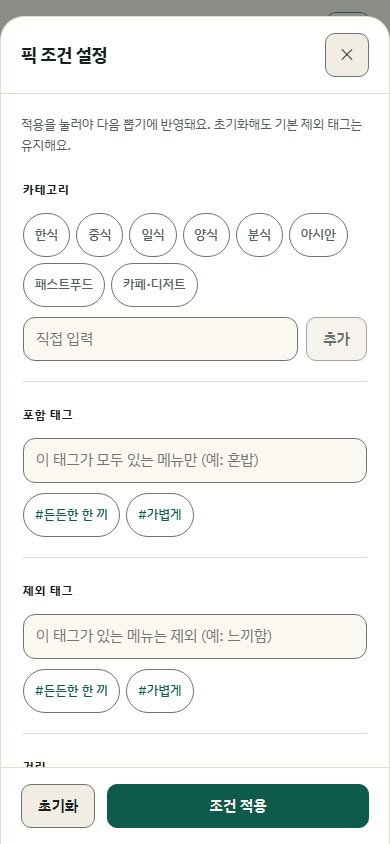
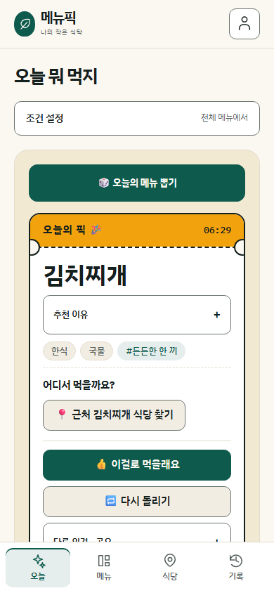
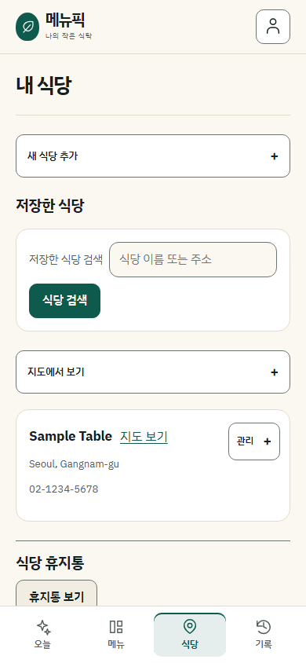

# 프런트 화면 개선

## 방향

메뉴픽은 자주 먹는 메뉴를 모으고, 한 끼를 고르고, 방문을 기록하는 서비스다. 음식 브랜드의 편안한 색감과 큰 제목을 참고하되, 뽑기·검색·수정 버튼을 찾기 쉬운 화면으로 구성했다.

## 참고한 사이트

| 참고 자료 | 확인한 내용 | 메뉴픽에 적용한 부분 |
| --- | --- | --- |
| [Awwwards — Food & Drink](https://www.awwwards.com/websites/food-drink/) | 음식·음료 사이트를 모은 갤러리. 실제 브라우저 화면도 확인했다. | 크림색 배경, 짙은 녹색 강조, 음식과 관련된 중심 이미지 |
| [Siteinspire](https://www.siteinspire.com/) | Editorial·Minimal·Food & Drink 분류와 [Union Boulangerie 소개](https://www.siteinspire.com/website/13641-union-boulangerie), [실제 사이트](https://unionboulangerie.com/)를 확인했다. | 큰 제목과 여백, 적은 수의 강조 요소. 메뉴픽에는 직접 그린 SVG 식탁 일러스트를 사용했다. |
| [Land-book](https://land-book.com/) | 공식 페이지의 Big Type·Bottom Navigation·Food & Drinks 분류를 확인했다. 브라우저 갤러리는 보안 확인 화면에 막혀 시각 검토하지 못했다. | 큰 제목과 모바일 하단 탐색을 검토할 참고 분류로 활용했다. |
| [Lapa Ninja — Food & Drinks](https://www.lapa.ninja/category/food-drinks/) | 음식 서비스의 랜딩 페이지 사례를 모은 공개 목록을 확인했다. | 로그인 화면을 소개 영역과 실제 입력 영역으로 나누는 방향을 참고했다. |
| [Mobbin](https://mobbin.com/) | 공식 홈페이지의 앱 UI 레퍼런스 서비스 소개를 확인했다. 로그인 이후의 라이브러리는 열람하지 않았다. | 앱 탐색 구조를 검토하는 출발점으로 참고했다. 특정 앱의 흐름을 복제하지 않았다. |

색상·배치에 대한 판단은 메뉴픽의 화면에 맞춘 설계 판단이다. 참고 사이트의 이미지·영상·소스 코드는 가져오지 않았다.

### 모바일 구성에 참고한 공개 화면

| 자료 | 확인한 구성 | 적용 |
| --- | --- | --- |
| [캐치테이블 공식 App Store](https://apps.apple.com/kr/app/id1485193566) | 예약 조건을 선택하고 하단에서 적용하는 공개 화면 | 선택 중인 초안과 실제 적용 조건 분리 |
| [쿠팡이츠 공식 App Store](https://apps.apple.com/kr/app/id1445504255) | 상단 검색, 짧은 카테고리 묶음, 가로 탐색 | 홈에 자주 쓰는 카테고리와 조건 요약 표시 |
| [Airbnb 2024 Winter Release](https://news.airbnb.com/product-releases/airbnb-2024-winter-release/) | 선택 조건을 해제하는 칩과 필터 화면 하단의 초기화·적용 동작 | 상세 조건은 바텀시트, 적용한 태그·거리는 홈에서 해제 |
| [Material 바텀시트 가이드](https://m3.material.io/components/bottom-sheets/guidelines) | 보조 작업을 별도 영역에서 열고 닫는 방식 | 내부 스크롤과 고정된 적용 버튼, 닫기·Escape·배경 클릭 |
| [Apple 탭바 가이드](https://developer.apple.com/design/human-interface-guidelines/tab-bars) | 주요 화면 이동과 현재 화면의 동작 구분 | 하단 네 개 탭, 별도의 계정 메뉴와 뽑기 버튼 |

App Store 자료는 개발사가 제공한 홍보 화면이고, Airbnb 자료는 2024년 공개 사례다. 최신 앱에 로그인해서 전체 사용자 흐름을 검증한 자료는 아니다.

## 바꾼 화면

### 탐색

- PC에서는 왼쪽에 주요 화면을 배치했다. 현재 화면은 채운 배경과 굵은 글씨로 표시한다.
- 760px 이하에서는 아래쪽에 오늘·메뉴·식당·기록 네 개 탭을 배치했다. 설정과 로그아웃은 상단 계정 메뉴에서 연다.
- 모바일 하단의 기기 안전 영역과 본문 여백을 확보했다. 초점이 이동할 때 하단 메뉴에 가리지 않도록 스크롤 여유도 둔다.
- 본문 건너뛰기 링크, 현재 위치의 `aria-current`, 경로 전환 시 본문 초점 이동은 유지한다.

### 오늘 뭐 먹지

모바일 홈에는 카테고리와 적용 중인 조건 요약을 보여준다. 태그·거리·최근 메뉴 제외는 '조건 설정'을 눌러 바텀시트에서 고른다. 처음 쓰는 사람에게 필요한 메뉴 등록 안내와 지난 방문 확인은 기존대로 먼저 표시한다.

시트에서는 초안을 편집한다. '조건 적용'을 누르기 전까지 뽑기 요청은 바뀌지 않는다. 닫기·Escape·배경 클릭과 PC 폭으로의 전환은 초안을 취소한다. 초기화는 기본 제외 태그를 유지하고, 기본 제외도 직접 해제하면 빈 배열을 서버에 보내 그 의사를 전달한다. 취소한 위치 요청의 늦은 응답은 무시한다.

결과가 나오면 장식용 접시를 접고 같은 영역에 결과를 보여준다. 긴 조건 목록 때문에 결과가 아래로 밀리는 일을 줄인다. 카테고리·태그·거리·최근 메뉴 제외와 빠른 픽의 동작은 기존 API를 사용한다.

추천 이유와 공유·추가 의견은 접어서 제공한다. 함께 뽑기와 조건 저장은 결과 아래에서도 계속 열 수 있다.


[어두운 테마 화면](images/frontend-refresh-dark.png)도 같은 색상 토큰으로 구성했다.





### 로그인과 메뉴 목록

로그인은 소개 영역과 입력 영역으로 나눴다. 모바일에서는 소개를 짧게 접어 폼을 이어서 보여준다. 이메일·소셜 로그인과 가입 없는 샘플 뽑기는 유지한다.

메뉴 목록은 넓은 화면에서 두 열 카드, 모바일에서는 간결한 한 열 목록으로 표시한다. 모바일의 수정·추천 제외·쉬기·삭제는 각 항목의 '관리' 버튼으로 연다. 수정 폼을 취소하면 다시 관리 버튼으로 초점을 돌린다.

기록 화면은 모바일에서 최근 기록 목록을 먼저 표시한다. 식사 통계와 방문 달력은 목록 아래에서 펼치고, 내려받기도 필요할 때 연다.

[모바일 메뉴 목록](images/frontend-mobile-menus.png) · [모바일 기록](images/frontend-mobile-history.png)

### 저장한 식당

모바일에서는 저장한 식당을 먼저 찾을 수 있도록 장소 추가 폼과 지도를 접어 둔다. 각 식당의 수정·메뉴 연결·삭제는 '관리'에서 연다. 수정 폼을 취소하면 관리 버튼으로 초점을 돌린다. 추가 폼을 접었다 다시 열어도 검색어를 유지하며, 휴지통은 목록 아래에 둔다. PC에서는 기존 추가·관리 동작을 펼쳐 둔다.




## 구현과 검증

- `index.css`의 공통 색상과 접근성 규칙을 사용한다. 화면 배치는 `design.css`, 모바일의 작업별 구성과 시트는 `mobile.css`에서 관리한다.
- 일러스트와 탐색 아이콘은 React의 인라인 SVG다. 이미지 CDN이나 UI 패키지를 추가하지 않았다. 사용하지 않게 된 Black Han Sans의 외부 폰트 요청도 제거했다.
- 밝은 테마와 어두운 테마, 동작 줄이기 설정, 200% 기본 글자 크기로 뽑기·메뉴·로그인 화면을 확인했다.
- 320·390·820·1440px 브라우저 테스트에서 뽑기와 결과의 화면 내 표시, 버튼 클릭 가능 여부, 조건 선택, 탐색 접근, 가로 넘침을 확인했다.
- 조건 적용·취소·초기화, 위치 응답 경합, PC 폭 전환, 초점 복원과 키보드 순환, 200% 글자 확대, VisualViewport 축소 대응을 브라우저에서 확인했다.
- StrictMode의 효과 재실행을 첫 화면 진입과 구분하도록 수정해 초기 초점 이동을 막았다. 화면을 옮길 때는 본문 초점과 스크롤 위치를 갱신한다.
- 프런트 단위 테스트 562개, 브라우저 테스트 35개를 통과했다. 빌드와 린트도 확인했다. 린트에는 기존 `AuthContext.tsx`의 Fast Refresh 경고 1건이 남아 있다.

캡처는 고정된 샘플 API 응답으로 만들었다. 실제 사용자 데이터나 운영 서버 응답이 아니다. 화면 키보드 대응은 VisualViewport 축소를 모사해 검증했으며 실제 iOS·Android 기기 확인은 남아 있다. 초기 안내·긴 메뉴 이름·저장한 식당과 같이 내용에 따라 높이가 달라지는 화면은 운영 데이터에서도 계속 확인해야 한다. 전환율이나 뽑기 완료 시간 개선은 아직 측정하지 않았다.

로컬 실행:

```sh
cd frontend
npm run dev
```

로그인 뒤 화면의 실제 사용에는 기존 백엔드 연결이 필요하다. 위 캡처용 API 대역은 제품 코드에 포함하지 않았다.
