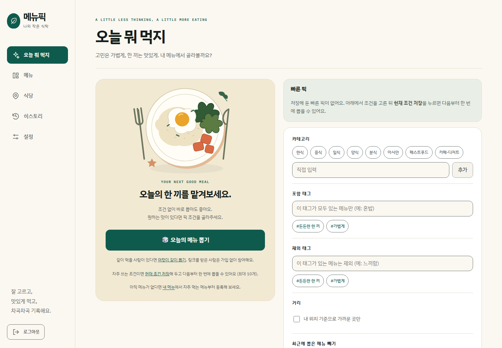
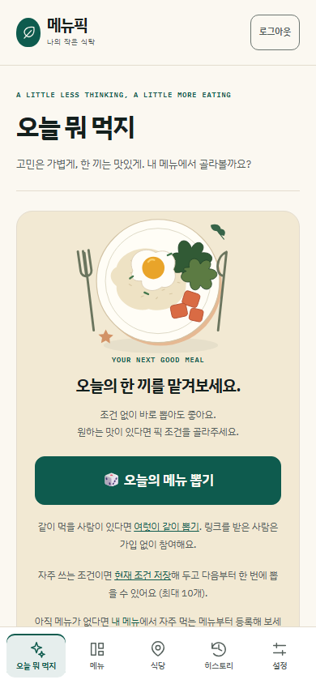
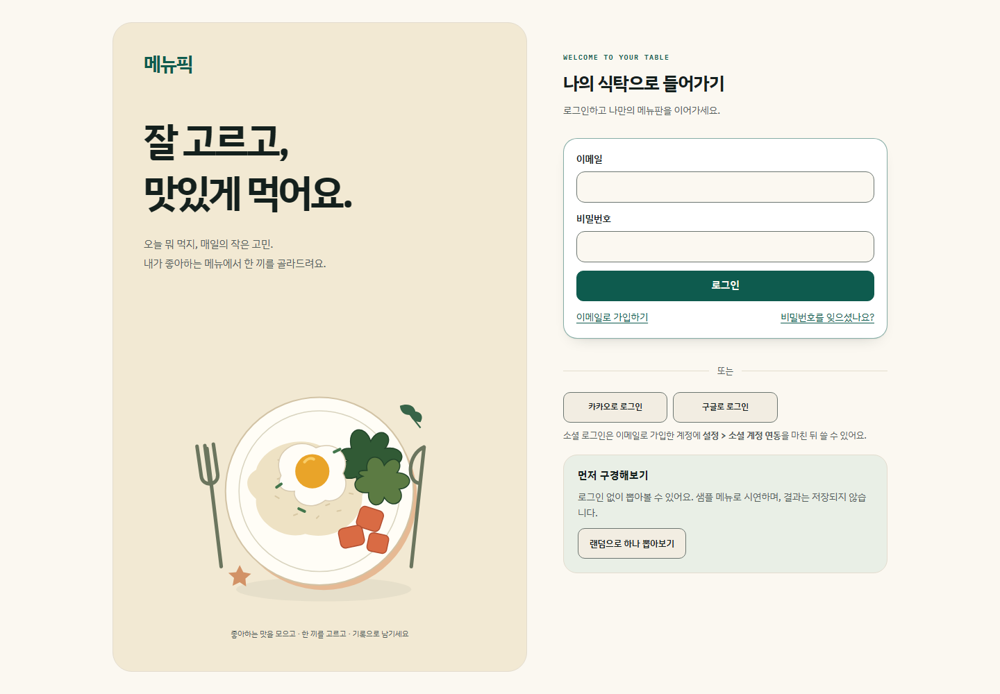

# 프런트 화면 개선

## 방향

메뉴픽은 자주 먹는 메뉴를 모으고, 한 끼를 고르고, 방문을 기록하는 서비스다. 음식 브랜드의 편안한 색감과 큰 제목을 참고하되, 뽑기·검색·수정 버튼을 찾기 쉬운 화면으로 구성했다.

## 참고한 사이트

| 참고 자료 | 확인한 내용 | 메뉴픽에 적용한 부분 |
| --- | --- | --- |
| [Awwwards — Food & Drink](https://www.awwwards.com/websites/food-drink/) | 음식·음료 사이트를 모은 갤러리. 실제 브라우저 화면도 확인했다. | 크림색 배경, 짙은 녹색 강조, 음식과 관련된 중심 이미지 |
| [Siteinspire](https://www.siteinspire.com/) | Editorial·Minimal·Food & Drink 분류와 [Union Boulangerie 소개](https://www.siteinspire.com/website/13641-union-boulangerie), [실제 사이트](https://unionboulangerie.com/)를 확인했다. | 큰 제목과 여백, 적은 수의 강조 요소. 메뉴픽에는 직접 그린 SVG 식탁 일러스트를 사용했다. |
| [Land-book](https://land-book.com/) | 공식 페이지의 Big Type·Bottom Navigation·Food & Drinks 분류를 확인했다. 브라우저 갤러리는 보안 확인 화면에 막혀 시각 검토하지 못했다. | 큰 제목과 모바일 하단 탐색을 검토할 참고 분류로 활용했다. |
| [Lapa Ninja — Food & Drinks](https://www.lapa.ninja/category/food-drinks/) | 음식 서비스의 랜딩 페이지 사례를 모은 공개 목록을 확인했다. | 로그인 화면을 소개 영역과 실제 입력 영역으로 나누는 방향을 참고했다. |
| [Mobbin](https://mobbin.com/) | 공식 홈페이지의 앱 UI 레퍼런스 서비스 소개를 확인했다. 로그인 이후의 라이브러리는 열람하지 않았다. | 앱 탐색 구조를 검토하는 출발점으로 참고했다. 특정 앱의 흐름을 복제하지 않았다. |

색상·배치에 대한 판단은 메뉴픽의 화면에 맞춘 설계 판단이다. 참고 사이트의 이미지·영상·소스 코드는 가져오지 않았다.

## 바꾼 화면

### 탐색

- PC에서는 왼쪽에 주요 화면을 배치했다. 현재 화면은 채운 배경과 굵은 글씨로 표시한다.
- 760px 이하에서는 위쪽에 서비스 이름과 로그아웃, 아래쪽에 다섯 개의 탐색 링크를 배치했다.
- 모바일 하단의 기기 안전 영역과 본문 여백을 확보했다. 초점이 이동할 때 하단 메뉴에 가리지 않도록 스크롤 여유도 둔다.
- 본문 건너뛰기 링크, 현재 위치의 `aria-current`, 경로 전환 시 본문 초점 이동은 유지한다.

### 오늘 뭐 먹지

기존에는 조건 입력을 지나야 뽑기 버튼을 만났다. 뽑기와 조건을 나누고, 모바일에서도 뽑기를 먼저 만나는 DOM 순서로 바꿨다. 처음 쓰는 사람에게 필요한 메뉴 등록 안내와 지난 방문 확인은 기존대로 먼저 표시한다.

결과가 나오면 장식용 접시를 접고 같은 영역에 결과를 보여준다. 긴 조건 목록 때문에 결과가 아래로 밀리는 일을 줄인다. 카테고리·태그·거리·최근 메뉴 제외와 빠른 픽의 동작은 기존 API를 사용한다.





[어두운 테마 화면](images/frontend-refresh-dark.png)도 같은 색상 토큰으로 구성했다.

### 로그인과 메뉴 목록

로그인은 소개 영역과 입력 영역으로 나눴다. 모바일에서는 소개를 짧게 접어 폼을 이어서 보여준다. 이메일·소셜 로그인과 가입 없는 샘플 뽑기는 유지한다.

메뉴 목록은 넓은 화면에서 두 열, 모바일에서 한 열로 표시한다. 검색 영역, 제목, 카드 간격도 함께 정리했다.



## 구현과 검증

- `index.css`의 공통 색상과 접근성 규칙을 사용하고, 현재 화면 배치는 `design.css`에 모았다. 기존 화면별 CSS를 모두 재작성하지는 않았다.
- 일러스트와 탐색 아이콘은 React의 인라인 SVG다. 이미지 CDN이나 UI 패키지를 추가하지 않았다. 사용하지 않게 된 Black Han Sans의 외부 폰트 요청도 제거했다.
- 밝은 테마와 어두운 테마, 동작 줄이기 설정, 200% 기본 글자 크기로 뽑기·메뉴·로그인 화면을 확인했다.
- 320·390·820·1440px 브라우저 테스트에서 뽑기와 결과의 화면 내 표시, 버튼 클릭 가능 여부, 조건 선택, 탐색 접근, 가로 넘침을 확인했다.
- 프런트 단위 테스트 561개, 브라우저 테스트 23개를 통과했다. 빌드와 린트도 확인했다. 린트에는 기존 `AuthContext.tsx`의 Fast Refresh 경고 1건이 남아 있다.

캡처는 고정된 샘플 API 응답으로 만들었다. 실제 사용자 데이터나 운영 서버 응답이 아니다. 초기 안내·긴 메뉴 이름·저장한 식당과 같이 내용에 따라 높이가 달라지는 화면은 운영 데이터에서도 계속 확인해야 한다. 전환율이나 뽑기 완료 시간 개선은 아직 측정하지 않았다.

로컬 실행:

```sh
cd frontend
npm run dev
```

로그인 뒤 화면의 실제 사용에는 기존 백엔드 연결이 필요하다. 위 캡처용 API 대역은 제품 코드에 포함하지 않았다.
